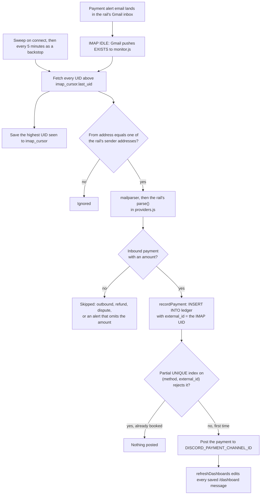
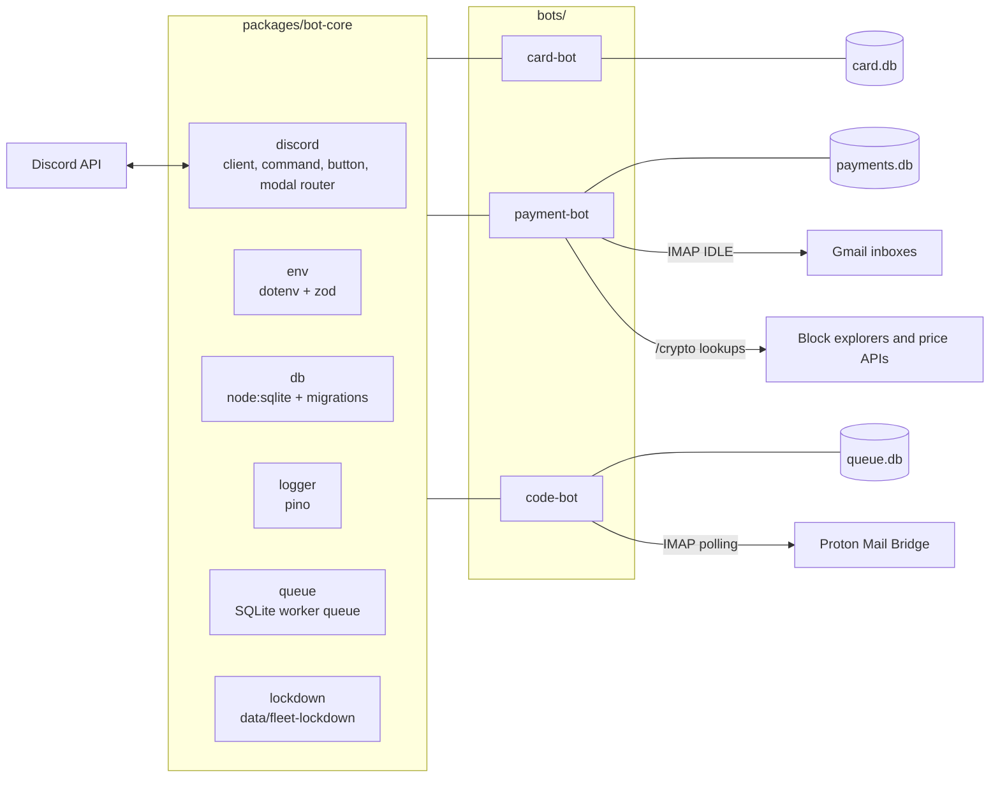

# opscore

[](https://github.com/davidajudua/opscore/actions/workflows/ci.yml)

Three Discord bots that run the back office of a small business, built on one shared Node.js core and supervised by PM2.
Employees use them to get company cards, to confirm that a customer really paid, and to see revenue, without a shared spreadsheet or a shared inbox password.

| Bot | What it does for the business |
|---|---|
| [card-bot](bots/card-bot/README.md) | Hands an employee one card from the business's own bank accounts (for example Amex or Capital One) with `/card`, and records who claimed it. Cards are encrypted at rest. |
| [payment-bot](bots/payment-bot/README.md) | Watches the payment-alert inboxes for Zelle, Venmo and PayPal and posts each payment to Discord. A customer saying "I paid" no longer counts. The payment counts when the bank's or app's own alert email arrives. It also keeps a ledger and a live revenue panel. |
| [code-bot](bots/code-bot/README.md) | Hands out the one-time codes that the business's card accounts send (Amex SafeKey, Capital One purchase codes), to one employee at a time. |

## How a payment gets confirmed

payment-bot holds one IMAP connection per payment rail and reacts to the server's push instead of polling.
The ledger books each email once, however many times it is seen.



The partial unique index `ledger_method_external_idx` on `ledger(method, external_id) WHERE external_id IS NOT NULL` is what makes the ledger idempotent.
`recordPayment` catches the constraint error and returns `{ inserted: false }`, so a re-sent alert, an overlapping sweep, or a restart books nothing twice and posts nothing twice.
Crypto payments from `/crypto` use the same index, with the transaction hash as `external_id`.

## How the pieces fit

Each bot is its own PM2 process, started from `pm2.config.cjs`, with its own SQLite file.
Every bot imports `packages/bot-core`, and its `discord` module owns the connection to Discord.
The [bot-core modules](#bot-core-modules) table lists which bot uses which module.
The bots share code, not state, except for the fleet lockdown file.



payment-bot's dashboard has **Lock** and **Unlock** buttons that create and delete `data/fleet-lockdown`.
While that file exists, card-bot refuses `/card`.

## Run the tests

You need Node.js 22.13 or newer, the first 22.x release where `node:sqlite` works without a flag.

```bash
npm ci
npm test
npm run lint
```

`npm test` runs every workspace's suite.
card-bot's suite reads the raw bytes of its SQLite file and WAL, and fails if any card number or CVV is stored in plaintext.

## Run the bots

1. Install dependencies and copy the config templates.

   ```bash
   npm install
   cp .env.example .env
   for b in card-bot payment-bot code-bot; do cp bots/$b/.env.example bots/$b/.env; done
   ```

2. Generate the card encryption key.

   ```bash
   node -e "console.log(require('node:crypto').randomBytes(32).toString('base64'))"
   ```

   Paste the output after `CARD_ENCRYPTION_KEY=` in `bots/card-bot/.env`, and store a copy somewhere other than this server.

3. Fill in the rest of each `bots/<bot>/.env`. Each template lists its settings.

4. Start the bots.
   - On Linux, run `bash install.sh`. It installs PM2 if it is missing, runs `npm install`, then `pm2 startOrReload` and `pm2 save`. It warns about any bot without a `.env`. That bot then exits at boot while the others run.
   - On Windows, run `start.bat`. It refuses to start until all three `.env` files exist, then opens a control panel that takes `start`, `stop`, `restart`, `status`, `cleanup` and `quit`.

Each bot validates its `.env` with a zod schema at boot and exits with a list of what is missing or invalid.
Each bot creates its SQLite file under `bots/<bot>/data/` and applies its migrations on first start.

## Security

This section states what each bot stores, what is protected, and what you are responsible for when you run it.

### What each bot stores

| Bot | File | Contents | Encrypted |
|---|---|---|---|
| card-bot | `bots/card-bot/data/card.db` | Cards in stock and cards out on a claim: number, expiry, CVV and zip | Yes, AES-256-GCM. Stored next to them are an HMAC-SHA256 fingerprint of the number (for the duplicate check) and the last four digits. |
| card-bot | same file | Providers with their default zip and expiry, who claimed a card and when, whitelisted channels, prices, settings | No |
| payment-bot | `bots/payment-bot/data/payments.db` | Ledger rows: amount, rail, the payer's name from the alert email, IMAP UID or transaction hash, notes. Per-rail IMAP cursor. Dashboard message ids. | No |
| code-bot | `bots/code-bot/data/queue.db` | Queue of waiting Discord users, and the codes it has served with their email UID or Discord message id, so no code is handed out twice. Rows older than an hour are deleted on the next fetch. | No |
| all | `logs/<bot>/` | pino logs, rotated daily or at 5 MB. Old files are kept. card-bot logs only the last four digits of a card. payment-bot logs the payer's name and amount. code-bot logs each code it captures. | No |

### Card encryption

`bots/card-bot/src/card-vault.js` is the only code that seals or opens a card.
It derives three values from `CARD_ENCRYPTION_KEY` with HKDF: the AES-256-GCM key, the HMAC key for fingerprints, and a short key id stored with every card.
A card is opened in memory in two places only: when it is handed to the employee who claimed it, and when an admin runs `/export`.

card-bot refuses to start if `CARD_ENCRYPTION_KEY` is missing or malformed, or if the database holds cards sealed with a different key.
Migration `016_seal_cards.js` converts a database from before encryption in place, under SQLite's `secure_delete`, and the bot then truncates the WAL, so the old plaintext does not stay in the file.

Key rotation is not implemented yet.
The stored key id is there so it can be added.

### Where secrets live

Secrets live only in the `.env` files, which are gitignored, as are `data/` and `logs/`.
They are Discord bot tokens, Gmail app passwords, the Proton Mail Bridge password, and `CARD_ENCRYPTION_KEY`.
The `.env` files are plain text, so restrict who can read them on the server.

### What you are responsible for

- **The card key.** Back up `CARD_ENCRYPTION_KEY` away from the server. Without it the stored cards cannot be opened. Anyone who has both the key and `card.db` can read every card.
- **The admin role.** Admin commands check for a Discord role whose name matches `ADMIN_ROLE_NAME`, compared case-insensitively. Anyone who can create or rename roles can give themselves that name, so limit the Manage Roles permission.
- **The card channels.** `/card` works only in channels an admin whitelists. The claim message shows the full card to everyone who can read that channel until the employee presses **Used**, **Error** or **Return**. Then the message is edited down to the last four digits. Keep those channels private. Discord keeps the messages on its servers.
- **The refund channel.** payment-bot does not check roles on the **Approve** and **Deny** buttons for refunds. Make `REFUND_CHANNEL_ID` visible to admins only.
- **The payment inboxes.** payment-bot trusts an alert when its From address exactly matches the rail's known sender. It does not verify DKIM or SPF itself, and relies on Gmail to reject forged senders. Use inboxes that receive only payment alerts.
- **The mailbox code-bot reads.** code-bot connects to Proton Mail Bridge, by default at `127.0.0.1:1143`. It accepts the Bridge's self-signed certificate, so keep the Bridge on the same machine. Anyone with access to that mailbox can read the codes too.

## Design decisions

- **Shared core, thin bots.** Config loading, SQLite and migrations, the Discord router and logging live in `@platform/bot-core`, so each bot holds only its own logic.
- **Routing by custom id.** Buttons and modals carry ids of the form `<botPrefix>:<action>:<args>`. The router dispatches on the action, so a button posted before a restart still works after it.
- **Migrations on boot.** Each bot keeps numbered migrations in `migrations/`. The core applies the pending ones at startup, each in its own transaction. A migration is a `.sql` file, or a `.js` file exporting `up(db, context)` for changes SQL cannot make, such as encrypting existing rows.
- **Crash, then restart.** PM2 restarts a bot that exits, with exponential backoff, and gives up after 10 restarts in a row that each last under a minute. State the bots need after a restart, such as open card claims and the code queue, lives in SQLite.
- **Fail fast on config.** Each bot parses its environment with a zod schema before it opens a database or connects to Discord.

## Repository layout

```
.
├── packages/
│   └── bot-core/          shared env, db, migrations, logger, Discord router, queue, lockdown
├── bots/
│   ├── card-bot/          card pool, /card claims, sealed card storage
│   ├── payment-bot/       payment-alert monitor, ledger, revenue dashboard
│   └── code-bot/          one-time code queue and fetchers
├── .github/workflows/     CI for this repository: lint and tests on Node 22 and 24
├── pm2.config.cjs         one PM2 process per bot
├── install.sh             Linux deploy with PM2, safe to re-run
└── start.bat              Windows control panel
```

## bot-core modules

| Module | What it does | Used by |
|---|---|---|
| `env` | Loads `bots/<bot>/.env` then the root `.env`, and validates `process.env` with a zod schema | all three bots |
| `db` | Opens SQLite with `node:sqlite` in WAL mode and runs `.sql` and `.js` migrations | all three bots |
| `discord` | discord.js client, slash command registration, button, modal, select and autocomplete routing, role checks | all three bots |
| `logger` | pino logger writing to the console and to rotating files | all three bots |
| `queue` | First-in, first-out worker queue in SQLite with one active user and an idle timeout | code-bot |
| `lockdown` | Fleet kill switch: a marker file at `data/fleet-lockdown` | card-bot, payment-bot |
| `http` | undici fetch wrapper with timeouts and JSON helpers | not used by these bots |
| `imap` | IMAP client wrapper | not used by these bots. payment-bot and code-bot use imapflow directly. |
| `supervisor` | Restarts an in-process async loop with backoff | not used by these bots |

## Tech

Node.js (ES modules), npm workspaces, discord.js, `node:sqlite`, `node:crypto`, imapflow, undici, zod, pino, PM2.

## License

[MIT](LICENSE). Copyright (c) 2026 David Ajudua.

## About this repository

This repository is published from a private monorepo.
Changes arrive here as snapshot commits, so a pull request opened here would be overwritten by the next publish.
To report a problem or ask a question, open an issue.
